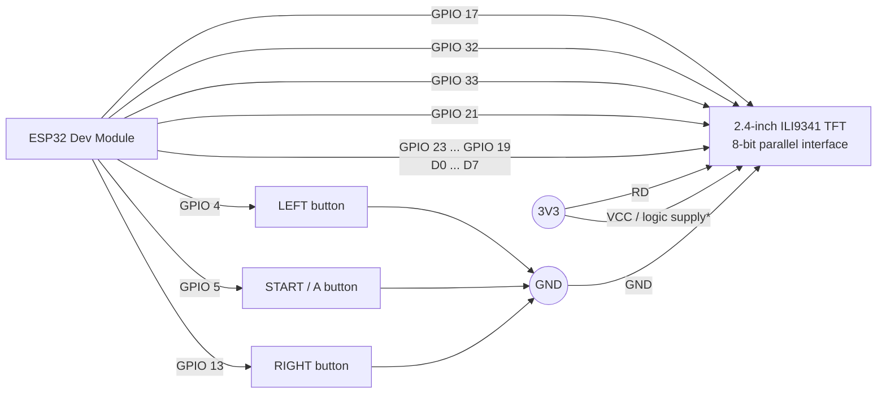

# KEYCHAIN BOY — ESP32 TFT Edition

A small, self-contained retro game console for a **classic ESP32 Dev Module** and a **2.4-inch 240 × 320, 8-bit parallel ILI9341 TFT**. The sketch renders a 128 × 64 virtual game screen, scales it to the TFT in landscape orientation, and stores each game's high score in the ESP32's non-volatile memory.

## Included games

- Alien Attack
- T-Rex Dash
- Flap Jump
- Snake
- Brick Buster

## Hardware

| Part | Notes |
| --- | --- |
| ESP32 Dev Module | Original/classic ESP32, not ESP32-C3/S2/S3 pinout |
| 2.4-inch TFT | 240 × 320, **8-bit 8080-style parallel** interface; ILI9341 controller assumed |
| 3 × momentary push-buttons | LEFT, START / A, RIGHT |
| Jumper wires and suitable power source | All logic must use **3.3 V** |

> **Important:** This project is wired for a parallel TFT, not the common SPI-only ILI9341 breakout. Do not apply 5 V to ESP32 GPIO or to a 3.3 V-only TFT input.

## Wiring diagram



\* Use the TFT board's supply pin appropriate to its regulator and level-shifting design. For a bare 3.3 V TFT, connect it to **3V3**. Its signal inputs must remain 3.3 V logic.

For a full-size vector version suitable for viewing or printing, open [the circuit diagram](keychain-boy-circuit.svg).

### TFT → ESP32 connections

| TFT pin / signal | ESP32 connection | Notes |
| --- | ---: | --- |
| `VCC` | `3V3` | See the power note above |
| `GND` | `GND` | A common ground is required |
| `RST` | GPIO 17 | TFT hardware reset |
| `CS` | GPIO 32 | Chip select |
| `RS` / `DC` | GPIO 33 | Register select / data-command |
| `WR` | GPIO 21 | Parallel write strobe |
| `RD` | `3V3` | Reads are disabled in the sketch; tie high |
| `D0` | GPIO 23 | Data bit 0 |
| `D1` | GPIO 22 | Data bit 1 |
| `D2` | GPIO 25 | Data bit 2 |
| `D3` | GPIO 26 | Data bit 3 |
| `D4` | GPIO 27 | Data bit 4 |
| `D5` | GPIO 14 | Data bit 5 |
| `D6` | GPIO 18 | Data bit 6 |
| `D7` | GPIO 19 | Data bit 7 |
| `LED` / `BL` *(optional)* | GPIO 16 | The supplied sketch uses PWM backlight control on this pin. Set `TFT_BACKLIGHT_PIN` to `-1` if the display backlight is wired directly to supply. |
| SD-card pins | **Not connected** | The SD interface is not used by this project. |

### Button wiring

Each button has one terminal connected to the ESP32 GPIO and the other terminal connected to **GND**. The sketch enables the ESP32's internal pull-up resistors, so no external pull-up is required.

| Control | ESP32 GPIO | Action |
| --- | ---: | --- |
| LEFT | GPIO 4 | Move left, previous menu item, or turn left in Snake |
| START / A | GPIO 5 | Select, jump, flap, fire, launch, or restart |
| RIGHT | GPIO 13 | Move right, next menu item, or turn right in Snake |
| LEFT + RIGHT, hold ~0.4 s | — | Return to the main menu |

## Connection checklist

```text
ESP32 3V3  ───────────── TFT VCC (when the TFT board is 3.3 V powered)
ESP32 GND  ───────────── TFT GND ─── button common terminals

GPIO17  ───────────────── TFT RST       GPIO23 ── TFT D0
GPIO32  ───────────────── TFT CS        GPIO22 ── TFT D1
GPIO33  ───────────────── TFT RS/DC     GPIO25 ── TFT D2
GPIO21  ───────────────── TFT WR        GPIO26 ── TFT D3
3V3     ───────────────── TFT RD        GPIO27 ── TFT D4
                                             GPIO14 ── TFT D5
GPIO16  ───────────────── TFT LED/BL*      GPIO18 ── TFT D6
                                             GPIO19 ── TFT D7

GPIO4   ── LEFT button  ── GND
GPIO5   ── START button ── GND
GPIO13  ── RIGHT button ── GND
```

\* Optional; only connect this if `LED` / `BL` is genuinely wired to GPIO 16. Otherwise power the TFT backlight as required by the module and change `TFT_BACKLIGHT_PIN` to `-1` in the sketch.

## Software setup

1. Install the [Arduino IDE](https://www.arduino.cc/en/software) or use PlatformIO.
2. In the Arduino Boards Manager, install the **ESP32 by Espressif Systems** platform and select **ESP32 Dev Module**.
3. In the Arduino Library Manager, install **LovyanGFX**.
4. Create a sketch (for example, `keychain_boy.ino`) and paste in the project source.
5. Connect the ESP32 by USB, select its port, and upload.

The sketch also uses `Preferences`, which is included with the ESP32 Arduino platform; no extra installation is needed.

## Display configuration

The supplied source is already set for this wiring:

```cpp
constexpr uint8_t TFT_ROTATION = 3;
constexpr bool TFT_INVERT_COLOURS = false;
constexpr int TFT_BACKLIGHT_PIN = 16;
constexpr bool TFT_BACKLIGHT_INVERTED = true;
constexpr uint8_t TFT_BRIGHTNESS = 255;
```

If the image is upside down, try changing `TFT_ROTATION` between `1` and `3`. If the screen has inverted colours, change `TFT_INVERT_COLOURS` to `true`. If the backlight does not respond correctly, first verify the board's `LED`/`BL` pin and then adjust `TFT_BACKLIGHT_PIN` or `TFT_BACKLIGHT_INVERTED`.

## Controls by game

| Game | LEFT / RIGHT | START / A |
| --- | --- | --- |
| Menu | Choose a game | Start selected game |
| Alien Attack | Move ship | Fire |
| T-Rex Dash | Duck / descend | Jump |
| Flap Jump | Flap | Flap |
| Snake | Turn left / right | — |
| Brick Buster | Move paddle | Launch ball / restart |

After a game over, press **START / A** to restart. Press LEFT, RIGHT, or hold LEFT + RIGHT to return to the menu after the brief game-over delay.

## Troubleshooting

| Symptom | Check |
| --- | --- |
| Blank but backlit display | Confirm `CS`, `RS/DC`, `WR`, `RST`, every `D0`–`D7` line, shared GND, and the ILI9341 controller assumption. |
| No backlight | Verify whether `LED`/`BL` is connected to GPIO 16. If it is permanently tied to supply, set `TFT_BACKLIGHT_PIN` to `-1`. |
| Screen is rotated or colours look wrong | Adjust `TFT_ROTATION` or `TFT_INVERT_COLOURS` as described above. |
| Buttons trigger continuously or do nothing | Verify each button goes from its GPIO to GND, with no external connection to 3V3. Keep `BUTTONS_ACTIVE_LOW = true`. |
| Upload fails | Check that **ESP32 Dev Module** and the correct USB serial port are selected. |

## Notes

- The display is driven as write-only: `RD` is tied to 3.3 V and `readable` is disabled.
- SD-card pins intentionally remain unconnected.
- High scores are retained across restarts in ESP32 Preferences storage.
- The game loop targets approximately 30 frames per second.

## License

Copyright (c) 2026 Yukiene404
Permission is hereby granted, free of charge, to any person obtaining a copy
of this software and associated documentation files (the "Software"), to deal
in the Software without restriction, including without limitation the rights
to use, copy, modify, merge, publish, distribute, sublicense, and/or sell
copies of the Software, and to permit persons to whom the Software is
furnished to do so, subject to the following conditions:
The above copyright notice and this permission notice shall be included in all
copies or substantial portions of the Software.
